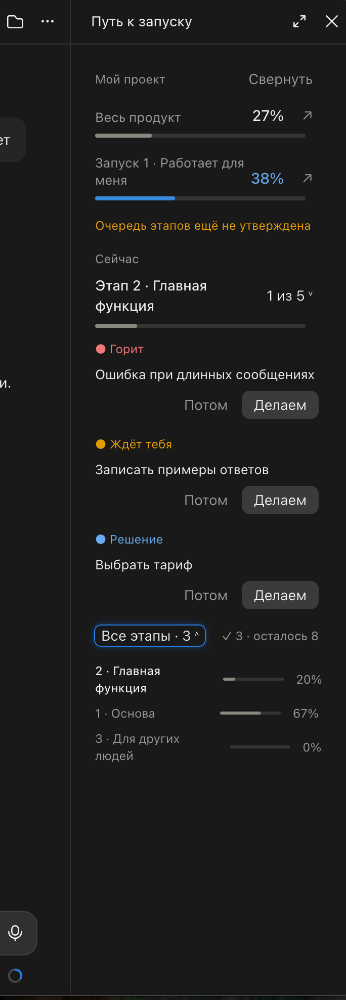
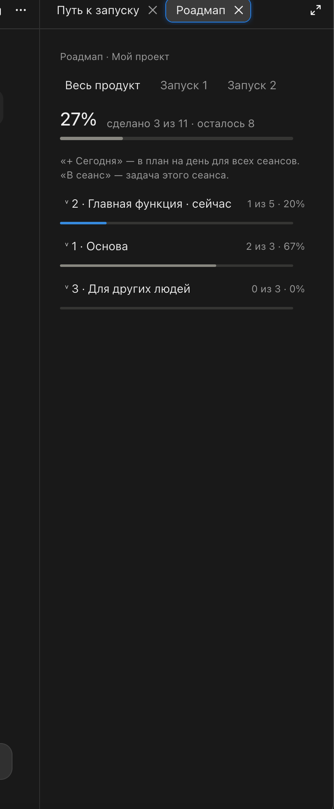
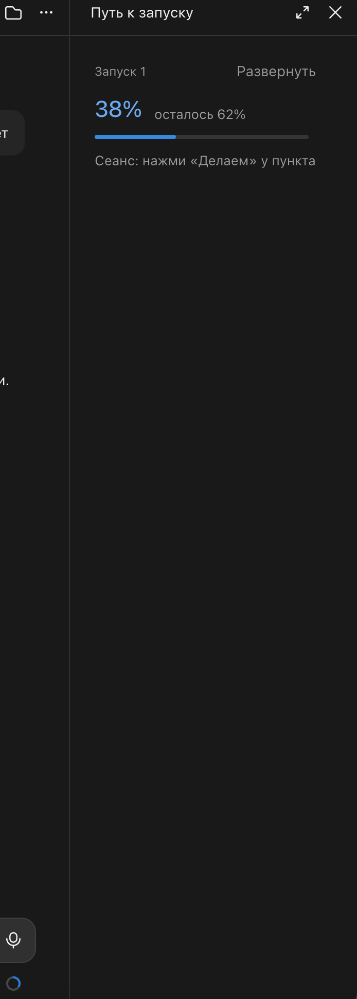

# Путь к запуску · Launch Path

**Панель для Claude Code, которая держит проект в фокусе:** этапы, проценты по галочкам, план на день, «что горит» и цель каждого сеанса — сбоку от чата.

**A side panel for Claude Code that keeps your project on track:** stages, progress by checkboxes, today's plan, what's on fire, and a goal for every session — right next to the chat.

> Интерфейс панели на русском. / The panel UI is in Russian (English README below).

<p align="center">
  
  
  
</p>
<p align="center"><sub>Панель · Окно «Роадмап» · Свёрнутая карточка — на примере из <code>examples/ЭТАПЫ.md</code> / Panel · Roadmap window · Collapsed card</sub></p>

---

## 🇷🇺 По-русски

### Зачем
Когда проект большой, а сеансов с Claude много, легко потерять нить: что уже сделано, что горит, чем занят соседний сеанс. Панель читает один файл `ЭТАПЫ.md` в папке проекта и показывает всё это одним взглядом. Цифры честные — по галочкам, а не «на глаз».

### Что умеет
- **Два процента наверху:** весь продукт и текущий запуск (запуск 1 → запуск 2).
- **«Сейчас»:** текущий этап и по одному пункту каждого вида — 🔥 горит, 🙋 ждёт тебя, ❓ решение.
- **«Сегодня»:** план дня, общий для всех сеансов (кнопка «+ Сегодня»).
- **«Делаем» / «В сеанс»:** берёте шаг в работу — Claude разбивает его на маленькие шаги и ведёт вас, показывая прогресс в панели.
- **Замок для параллельных сеансов:** шаги с меткой `#n8n` или `#сервер` в одной зоне — второй сеанс не возьмёт их, пока первый не закончит.
- **Окно «Роадмап»:** все этапы и шаги, фильтр по запускам, ссылка на красивую страницу роадмапа.
- **↻ Обновить роадмап** (по желанию): кнопка запускает вашу команду из шапки `ЭТАПЫ.md` (например, скрипт, который печатает HTML-роадмап) и просит Claude переиздать страницу — без ручного переписывания и лишних токенов.
- Свёрнутая карточка, работает и в терминале (без рисунков).

Мод не читает и не пишет ключи и пароли. Он работает только с файлом `ЭТАПЫ.md`.

### Установка
Нужен Claude Code 2.1.275 или новее. В чате Claude Code:

```
/plugin install put-k-zapusku --marketplace hakop970705-ops/claude-launch-path
```

Или в два шага:

```
/plugin marketplace add hakop970705-ops/claude-launch-path
/plugin install put-k-zapusku@claude-launch-path
```

Потом `/reload-plugins`.

### Как начать
1. Положите в корень проекта (или в `01_Память-Клода/`) файл `ЭТАПЫ.md` — пример в [examples/ЭТАПЫ.md](examples/ЭТАПЫ.md).
2. Панель откроется сама в начале сеанса. Вручную — командой `/zapusk`.

### Формат `ЭТАПЫ.md`
- Шапка между `---`: `проект`, `запуск_1`, `запуск_2`, `очередь` (порядок этапов), `роадмап` и `роадмап_запуск_1` (ссылки на страницы), `обновить_роадмап` (команда для кнопки ↻), `сегодня` (дата плана дня).
- Этап: `## 2 · Название · запуск 1`.
- Шаг: `- [x]` сделан · `- [ ]` не сделан · `- [/]` в работе.
- Метки: `#горит` `#ждёт` `#решение` `#клод` `#потом` `#сегодня`, зоны `#n8n` `#сервер`. Метку `@xxxxxxxx` (какой сеанс ведёт шаг) ставит и снимает сама панель.

---

## 🇬🇧 In English

### Why
On a big project with many Claude sessions it's easy to lose the thread: what's done, what's on fire, what the other session is doing. The panel reads a single `ЭТАПЫ.md` ("stages") file in your project and shows it all at a glance. Progress is honest — counted from checkboxes, not guessed.

### Features
- **Two progress bars:** whole product and current launch (launch 1 → launch 2).
- **"Now":** current stage plus one item of each kind — 🔥 blocker, 🙋 waiting for you, ❓ decision.
- **"Today":** a day plan shared by all sessions.
- **"Do it" / "To session":** take a step — Claude splits it into small steps and walks you through, with progress in the panel.
- **Lock for parallel sessions:** steps tagged `#n8n` or `#сервер` share one zone; a second session can't take them while the first one works.
- **Roadmap window:** all stages and steps, launch filter, link to your roadmap page.
- **↻ Refresh roadmap** (optional): runs your own command from the `ЭТАПЫ.md` header (e.g. a script that renders an HTML roadmap) and asks Claude to republish the page — no manual rewriting, few tokens.
- Collapsible card; works in the terminal too.

The mod never reads or writes keys or passwords — only `ЭТАПЫ.md`.

### Install
Claude Code 2.1.275+:

```
/plugin install put-k-zapusku --marketplace hakop970705-ops/claude-launch-path
```

Then `/reload-plugins`. Put an `ЭТАПЫ.md` file in your project root (see [examples/ЭТАПЫ.md](examples/ЭТАПЫ.md)); the panel opens at session start, or run `/zapusk`.

### File format (short)
Header keys: `проект` (project), `запуск_1` / `запуск_2` (launch names), `очередь` (stage order), `роадмап` / `роадмап_запуск_1` (roadmap links), `обновить_роадмап` (command for ↻), `сегодня` (day-plan date). Stage: `## 2 · Name · запуск 1`. Step: `- [x]` done, `- [ ]` todo, `- [/]` in progress. Tags: `#горит` blocker, `#ждёт` waiting, `#решение` decision, `#клод` Claude does it, `#потом` later, `#сегодня` today; zones `#n8n`, `#сервер`.

---

## Разработка · Development
Мод — это [Claude Code plugin](https://docs.claude.com/en/docs/claude-code/plugins) на TypeScript/JSX: `put-k-zapusku/hooks/register.tsx` (панели), `parse.ts` (разбор файла), `tests/panel.test.tsx` (18 тестов). Проверка: `claude plugin validate put-k-zapusku` и `claude plugin test put-k-zapusku`.

Лицензия / License: [MIT](LICENSE). Автор / Author: [Akop Arsenyan](https://github.com/hakop970705-ops).
